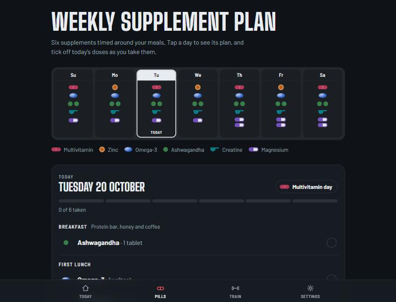
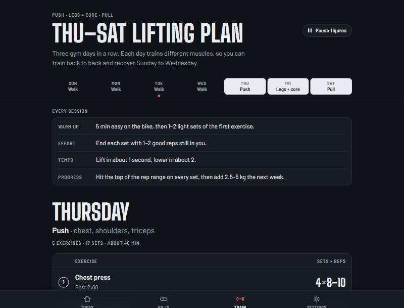
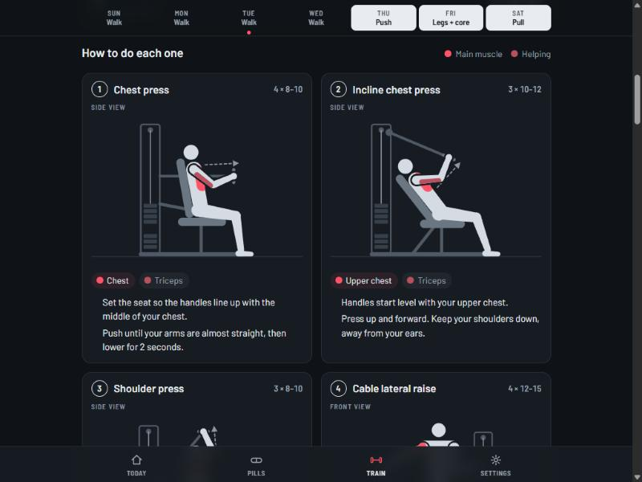

# Athena

## What it is

Athena is a small self-hosted supplements + gym tracker, installable as a PWA. It replaces two static HTML pages (a weekly supplement plan and a Thu–Sat lifting plan) with a server-backed app:

- a daily supplement plan with a seven-day pill box, tick-offs, gym-day doses and a Friday two-meal variant, all data-driven and editable;
- a lifting program with day sheets and exercise cues, plus a workout log (weights and reps per set, rest timer, progress charts);
- a handful of users (owner + trusted friends), each seeing only their own data;
- push reminders for meal slots and training days.

Everything lives in one SQLite file. The app is reached only over a private Tailscale network — there is no public exposure, no email, no OAuth.

<p align="center">
  
  
</p>
<p align="center">
  
</p>

Built end-to-end with [Claude Code](https://claude.com/claude-code) from a written spec (see SPEC.md), including the adversarial review pass whose findings are fixed in the git history.

## Run locally

```bash
npm install
npm run dev
```

The app runs at http://localhost:3000. The database is created at `./data/app.db` on first use (override with the `DATABASE_PATH` env var).

Create a user and load the default plans:

```bash
npm run create-user -- --username ibrahim --role owner
npm run seed -- --user ibrahim
```

Re-running the seed **replaces** that user's plans, logs, workouts and reminders with the defaults (reminders point at plan rows that get regenerated, so they are removed too — re-create them under Settings → Reminders).

## First user

```bash
npm run create-user -- --username ibrahim --role owner
```

The script prompts for the password twice (hidden input). Options:

| Option | Meaning |
| --- | --- |
| `--username` | required; 2–32 chars of `a-z 0-9 _ . -` |
| `--role` | `owner` or `member` (default `member`) |
| `--display-name` | defaults to the username |
| `--timezone` | IANA name, default `Asia/Riyadh` |
| `--password` | skip the prompt (for non-interactive use; it lands in your shell history) |

The owner gets `/admin` to create more users, reset passwords and delete users.

## Run with Docker

1. Copy `.env.example` to `.env` and fill it in. Generate the VAPID keys once:

   ```bash
   npx web-push generate-vapid-keys
   ```

   Put the two keys in `VAPID_PUBLIC_KEY` / `VAPID_PRIVATE_KEY`, set `VAPID_SUBJECT` to a `mailto:` address, `SESSION_SECRET` to any long random string, and `APP_URL` to the HTTPS URL you will use (your Tailscale URL, see below). Leave `DATABASE_PATH=/data/app.db` as is for Docker.

2. Build and start:

   ```bash
   docker compose up -d
   ```

   The database is stored on the host in `./data` (mounted at `/data` in the container). The container runs as a non-root user, restarts unless stopped, and has a healthcheck on `/api/health`.

3. Create the first user and seed it, inside the container:

   ```bash
   docker compose exec athena node scripts/create-user.mjs --username ibrahim --role owner
   docker compose exec athena node scripts/seed.mjs --user ibrahim
   ```

## Expose with Tailscale

On the host machine (already joined to your tailnet):

```bash
tailscale serve --bg --https=443 localhost:3000
```

The app is then reachable at `https://<machine>.<tailnet>.ts.net` for everyone on your tailnet, with valid HTTPS (required for push notifications and the PWA install). Set that URL as `APP_URL` in `.env`.

## Install on iPhone

Open the app's URL in Safari, tap **Share → Add to Home Screen**. The icon opens the app in a standalone window with no browser chrome.

## Enable reminders

Go to **Settings → Reminders** in the app, enable the reminders you want and set the times. On iOS, notifications only work after the app has been installed to the Home Screen (previous section) — open it from the Home Screen icon, then tap enable. Slot reminders are skipped automatically when everything in that slot is already ticked.

## Backups and restore

- A backup runs **daily at 03:00** inside the app itself (node-cron) — no sidecar container needed. It runs at 03:00 in the timezone set by `TZ` in `.env` (default `Asia/Riyadh`; the container itself runs in UTC). Backups land in `./data/backups/app-YYYY-MM-DD.db`; the newest 30 are kept.
- Run one manually at any time:

  ```bash
  npm run backup
  # or in Docker:
  docker compose exec athena node scripts/backup.mjs
  ```

  It uses SQLite's online backup (`sqlite3 .backup` semantics), so it is safe while the app is running.

- **Restore**: stop the container, **delete the WAL sidecar files**, copy a backup over the database file, start again. The delete step matters: the database runs in WAL mode, and a leftover `app.db-wal` from the old database would be replayed into the restored file and corrupt it.

  ```bash
  docker compose down
  del data\app.db-wal data\app.db-shm   # (rm -f on Linux/macOS; fine if they don't exist)
  copy data\backups\app-2026-10-18.db data\app.db   # (cp on Linux/macOS)
  docker compose up -d
  ```

## Reset a password

- **Easiest**: sign in as the owner and use `/admin` → reset password.
- The `create-user` script refuses existing usernames, so it cannot reset one. If you are locked out of the owner account, run this one-liner (first argument username, second the new password):

  ```bash
  docker compose exec athena node -e "const D=require('better-sqlite3'),a=require('argon2');(async()=>{const db=new D(process.env.DATABASE_PATH||'data/app.db');const h=await a.hash(process.argv[2]);const n=db.prepare('UPDATE users SET password_hash=? WHERE username=?').run(h,process.argv[1]).changes;console.log(n?'Password updated.':'No such user.');process.exit(n?0:1)})()" ibrahim "new-password"
  ```

  (Drop the `docker compose exec athena` prefix to run it against a local `./data/app.db`.)

## Changelog

One commit per milestone (see `git log`); each milestone's files landed in its own commit:

- `M1: foundation — SQLite schema + Drizzle, argon2 auth with DB sessions, health check, CLI create-user, Docker packaging`
- `M2: supplements — seven-day pill box, day plan with tick-offs and progress, Friday two-meal variant, gym-day doses, facts label, plan editor, history heat-strip`
- `M3: workouts — program overview and day sheets, workout logging with pre-fill and rest timer, history, Epley progress charts, program editor`
- `M4: PWA + reminders — manifest and icons, service worker with offline outbox, web push, per-slot and per-training-day reminders with idempotent sends`
- `M5: polish — admin page, daily 03:00 in-app backups + backup CLI, seed fixture matching the reference pages, README`
